# Boussole Budget — audit 360° et vision produit

> Version en ligne avec graphiques : https://claude.ai/artifact/2zJWqasfwQTA9Snnh7SQ7L (privée). Captures dans `captures/`, scénarios dans `scenarios.test.mjs`.

Boussole est aujourd'hui une maquette interactive soignée, pas encore un outil de décision. Son chiffre central, le « vrai disponible », est faux dans la plupart des situations réelles. La bonne nouvelle : le code est petit, propre, et le concept n'a pas d'équivalent direct sur le marché belge.

Audit réalisé le 17 novembre 2026 sur le commit `c8abe6c` (branche `claude/boussole-budget-mvp-5haKJ`). Aucun fichier de l'application n'a été modifié. Chaque constat porte un niveau de confiance ; les hypothèses sont signalées comme telles.

- **Vrai disponible affiché : 675,50 €**. Données de démonstration, au 29 mai 2026. Statut affiché : « Situation stable ».
- **Réellement dépensable : 98,50 €**. Jusqu'à la prochaine rentrée certaine (5 juin), loyer du 1er payé, réserve de 50 € gardée.
- **Scénarios de calcul : 16 / 16** situations testées révèlent un écart. Zéro test dans le dépôt.
- **Écrans sur données réelles : 7 / 10**. Conseils, Médiation et Documents affichent toujours la démo « Sophie ».

#### Solde projeté de la démo (revenus certains uniquement)

| Date    | Événement                              | Solde                    |
|---------|----------------------------------------|--------------------------|
| 29 mai  | Solde saisi                            | 847,50 €                 |
| 1 juin  | Loyer −650, transport −49              | **148,50 € (point bas)** |
| 5 juin  | Mutuelle +1 150, cantine −80, BNP −150 | 1 068,50 €               |
| 8 juin  | Assurance −18                          | 1 050,50 €               |
| 10 juin | Énergie −120, CHU −30                  | 900,50 €                 |
| 15 juin | Courses −300, téléphone −25, ING −50   | 525,50 €                 |
| 20 juin | Allocations +280, mutuelle compl. −35  | 770,50 €                 |

L'application affiche 675,50 € de vrai disponible. Le maximum dépensable sans passer sous la réserve de 50 € est 148,50 − 50 = **98,50 €**.

Une personne qui se fie au chiffre de l'application et dépense 300 € le 30 mai ne peut plus payer son loyer le 1er juin. C'est exactement le scénario que Boussole promet d'éviter. Tout le reste de cet audit découle de ce constat : **avant d'ajouter quoi que ce soit, il faut reconstruire le moteur de calcul sur un modèle daté**, puis le verrouiller par des tests.

## Rapport A — État des lieux

### Dépôt et branche de référence

- **Une seule branche distante** : `claude/boussole-budget-mvp-5haKJ`, 4 commits du 29 mai 2026. Pas de `main`, aucune pull request, aucune issue. C'est la référence de fait. La branche d'audit est identique.
- **Stack** : Next.js 16.2.6 (App Router, Turbopack), React 19.2, TypeScript strict, Tailwind 4. Trois dépendances de production, aucune superflue.
- **Taille** : 62 fichiers, environ 5 000 lignes. 12 routes, toutes pré-rendues en statique. Aucune API, aucun backend, aucune base de données.
- **Santé du build** : `tsc` sans erreur, `eslint` 2 avertissements, `next build` réussi.
- **Déploiement** : aucun projet « boussole » trouvé sur le compte Vercel accessible, aucune URL dans le dépôt. L'application a été auditée en local (build de production + serveur de dev).
- **Tests** : aucun. Pas de script `test`, pas de CI.

### Inventaire des écrans

| Écran                              | État réel        | Ce qui fonctionne                                                          | Ce qui manque ou trompe                                                                                     |
|------------------------------------|------------------|----------------------------------------------------------------------------|-------------------------------------------------------------------------------------------------------------|
| **Tableau de bord** — `/dashboard` | **Partiel**      | Solde modifiable, cartes, échéances, 2 conseils, raccourcis.               | Vrai disponible faux. Carte « Solde bancaire » invisible (blanc sur blanc). Alerte « médiateur » pour tous. |
| **Revenus** — `/revenus`           | **Opérationnel** | Ajout, modification, suppression, total, distinction confirmé / incertain. | La distinction n'a aucun effet sur le calcul. Date de versement non reconduite.                             |
| **Charges** — `/charges`           | **Opérationnel** | CRUD, regroupement par catégorie, ratio charges / revenus.                 | « Payé » sans effet. Totaux par catégorie faux hors mensuel.                                                |
| **Dettes** — `/dettes`             | **Partiel**      | CRUD, statuts, progression.                                                | Aucun enregistrement de paiement : le solde restant ne baisse jamais seul.                                  |
| **Projection** — `/projection`     | **Partiel**      | Jalons J0 / 7 / 15 / 30, liste d'événements par jour.                      | Décalage d'un jour en Belgique, fréquences ignorées, dates jamais reconduites.                              |
| **Objectifs** — `/objectifs`       | **Partiel**      | CRUD, barre de progression.                                                | Faisabilité choisie à la main par l'utilisateur. Contributions sans lien avec le budget.                    |
| **Frais enfants** — `/enfants`     | **Partiel**      | CRUD, regroupement par enfant, « à rembourser ».                           | Pollue le vrai disponible (historique compté comme charge mensuelle).                                       |
| **Conseils** — `/conseils`         | **Simulé**       | Affichage.                                                                 | Calculé sur les données de démo, jamais sur celles de l'utilisateur.                                        |
| **Médiation** — `/mediation`       | **Simulé**       | Affichage d'un dossier fictif.                                             | Lecture seule, données en dur. Aucun moyen d'encoder son propre dossier.                                    |
| **Documents** — `/documents`       | **Simulé**       | Liste fictive.                                                             | Upload et téléchargement désactivés (« bientôt disponible »).                                               |

### Absent de l'application

- Première ouverture, création de budget, écran profil et réglages
- Démarrage à vide (la démo est l'état par défaut)
- Comptes multiples, transferts, épargne séparée
- Historique des opérations réalisées
- Récurrence réelle et changement de mois

- Export, import, sauvegarde, synchronisation
- Authentification, multi-utilisateur
- Notifications et rappels
- Installation sur l'écran d'accueil (PWA)
- Mentions légales, politique de confidentialité

### Données et persistance

Tout l'état vit dans un seul contexte React (`lib/context/AppContext.tsx`) sérialisé en clair dans `localStorage` sous la clé `boussole-budget-v1`. La persistance fonctionne en production comme en développement (testé : ajout, rechargement, donnée conservée). Elle n'offre aucune protection contre la perte : un changement de téléphone ou un nettoyage du navigateur efface tout.

## Rapport B — Anomalies et risques

38 constats au total, dont 12 critiques. « Élevée » en confiance signifie reproduit par un test ou une capture ; « moyenne » signifie établi par lecture du code sans reproduction ; « à valider » signale un point juridique.

### Moteur de calcul

| ID     | Gravité      | Constat et impact utilisateur                                                                                                                                                                                                                                                                                       | Localisation                                                    | Confiance             | Correction recommandée                                                                               |
|--------|--------------|---------------------------------------------------------------------------------------------------------------------------------------------------------------------------------------------------------------------------------------------------------------------------------------------------------------------|-----------------------------------------------------------------|-----------------------|------------------------------------------------------------------------------------------------------|
| FIN-01 | **Critique** | Le vrai disponible additionne le solde et un mois complet de revenus, moins un mois complet de charges, sans tenir compte des dates. Un salaire déjà reçu est compté deux fois (+1 200 € dans S1). L'ordre des échéances est ignoré (675,50 € affichés contre 98,50 € réels).                                       | `budget-calculations.ts:64-73, 115-136`                         | Élevée (S1, S15)      | Remplacer par le point bas du solde projeté sur l'horizon, moins la réserve.                         |
| FIN-02 | **Critique** | Le statut « payé » n'a aucun effet. Si l'utilisateur met son solde à jour après un paiement, comme l'app le demande, la charge est déduite deux fois (650 € fictifs dans S2).                                                                                                                                       | `budget-calculations.ts:42-46`, `ExpenseForm.tsx:130-139`       | Élevée (S2, T8)       | Occurrences datées avec statut. Marquer payé ajuste le solde et retire l'échéance.                   |
| FIN-03 | **Critique** | Les revenus incertains sont comptés à 100 %, alors que l'app conseille elle-même de ne pas compter dessus.                                                                                                                                                                                                          | `budget-calculations.ts:35-39`                                  | Élevée (S3)           | Calcul prudent par défaut : revenus certains seuls. Afficher l'écart « si la pension arrive ».       |
| FIN-04 | **Critique** | Les dépenses et recettes ponctuelles valent 0 dans le vrai disponible et sont exclues de la projection. Une facture de 500 € due dans 7 jours est invisible, sauf dans les rappels.                                                                                                                                 | `budget-calculations.ts:27-28`, `projection.ts:67, 103`         | Élevée (S4)           | Toute opération datée entre dans la projection, quelle que soit sa fréquence.                        |
| FIN-05 | **Critique** | Chaque frais enfant déjà payé est soustrait à vie comme une charge mensuelle. Les remboursements attendus de l'autre parent ne sont jamais comptés. Après un an d'historique : −1 200 € fictifs.                                                                                                                    | `budget-calculations.ts:57-61`                                  | Élevée (S5)           | Un frais payé est une opération passée. La part à récupérer devient une recette attendue incertaine. |
| FIN-06 | **Critique** | En Belgique, toute la projection est décalée d'un jour (`toISOString()` convertit minuit local en veille UTC). Sur la démo, « Dans 7 jours » affiche 348,50 € au lieu de 1 268,50 €. Les événements du dernier jour ne sont jamais appliqués.                                                                       | `projection.ts:35-37, 171-178`                                  | Élevée (S8, capture)  | Un seul utilitaire de dates en chaînes locales `AAAA-MM-JJ`. Plus aucun passage par UTC.             |
| FIN-07 | **Critique** | Aucune récurrence réelle. Les dates sont saisies une fois et jamais reconduites. Une fois dépassée, l'échéance disparaît sans être signalée en retard. Aujourd'hui, la démo n'affiche plus qu'un événement.                                                                                                         | `projection.ts:72-77, 108-112`, `types.ts:23, 37, 55`           | Élevée (S10, capture) | Règle de récurrence (jour du mois, fréquence, début, fin) et génération d'occurrences.               |
| FIN-08 | **Élevée**   | La projection ignore les fréquences : un revenu hebdomadaire est compté une fois en 30 jours (200 € au lieu d'environ 800 €). Sans date, l'app invente le 5 pour les revenus et le 15 pour les charges.                                                                                                             | `projection.ts:78-86, 113-121`                                  | Élevée (S9)           | Générer toutes les occurrences dans la fenêtre. Exiger un jour pour toute récurrence.                |
| FIN-09 | **Élevée**   | La capacité d'épargne est égale au vrai disponible, donc à un stock et non à une marge mensuelle. L'app conseille d'épargner 202 € quand la marge réelle est de 123 € (−77 € sans la pension). Les contributions aux objectifs ne sont déduites nulle part. Les deux fonctions prévues pour cela sont du code mort. | `budget-calculations.ts:84-112, 149`, `advice-engine.ts:89-101` | Élevée (S6, S14)      | Capacité = revenus certains − charges − dettes − provisions. Faisabilité calculée, jamais saisie.    |
| FIN-10 | **Élevée**   | Dettes : aucun paiement enregistrable, le solde restant ne baisse jamais, la mensualité reste due même quand il ne reste que 40 €, les arriérés sans mensualité sont ignorés.                                                                                                                                       | `budget-calculations.ts:49-54`, `projection.ts:136-153`         | Élevée (S12)          | « Enregistrer un paiement » décrémente le solde restant. Dernière mensualité plafonnée.              |
| FIN-11 | **Élevée**   | Un budget vide affiche −50,00 € et « Situation critique, contacte ton médiateur ». Les seuils de risque diffèrent entre le tableau de bord (% des charges) et la projection (3 × la réserve).                                                                                                                       | `budget-calculations.ts:76-81`, `projection.ts:180-184`         | Élevée (S0, capture)  | État vide dédié. Une seule définition du risque, fondée sur le point bas.                            |
| FIN-12 | **Moyenne**  | Une échéance du jour n'apparaît pas dans les rappels. Une charge payée y reste. Un impayé passé en disparaît.                                                                                                                                                                                                       | `budget-calculations.ts:166-194`                                | Élevée (S11)          | Comparer des dates, pas des instants. Section « en retard ».                                         |
| FIN-13 | **Moyenne**  | Montants en nombres flottants : 0,10 + 0,20 − 0,30 donne −5,5 × 10⁻¹⁷, donc « danger ». Hebdomadaire × 4,33 au lieu de 52 / 12. Le score de risque vaut `NaN` quand charges et disponible sont nuls.                                                                                                                | `budget-calculations.ts:15-32, 137-147`                         | Élevée (S13, S0b)     | Centimes entiers partout. Supprimer le score de risque, inutilisé.                                   |
| FIN-14 | **Moyenne**  | Les totaux par catégorie additionnent les montants bruts : une assurance annuelle de 600 € pèse 600 € dans son groupe et 50 € dans le total de la page.                                                                                                                                                             | `charges/page.tsx:34-37`, `ExpenseList.tsx:52`                  | Moyenne               | Une seule fonction d'équivalent mensuel, utilisée partout.                                           |
| FIN-15 | **Moyenne**  | Montants négatifs acceptés pour les dettes : un restant dû de −500 € réduit le total des dettes, une mensualité de −50 € augmente le disponible.                                                                                                                                                                    | `DebtForm.tsx:33-37`                                            | Élevée (T9)           | Validation de schéma commune aux formulaires et au stockage.                                         |

### Conseils et alertes

| ID     | Gravité      | Constat et impact utilisateur                                                                                                                                                             | Localisation                                             | Confiance   | Correction recommandée                                                                             |
|--------|--------------|-------------------------------------------------------------------------------------------------------------------------------------------------------------------------------------------|----------------------------------------------------------|-------------|----------------------------------------------------------------------------------------------------|
| ADV-01 | **Critique** | La page Conseils est calculée sur les données de démo. Avec un solde de −900 € et aucune dette, elle recommande toujours d'épargner 202 € et parle de « dette contestée ».                | `app/conseils/page.tsx:22-31`                            | Élevée (T6) | Brancher sur l'état réel ou retirer la page.                                                       |
| ADV-02 | **Élevée**   | Conseils en dur affichés à tous : « La pension alimentaire n'est pas toujours versée à temps », réserve de « 150 € » quel que soit le réglage, « Contacte ton médiateur » sans médiation. | `advice-engine.ts:104-123`, `dashboard/page.tsx:110-114` | Élevée (S7) | Chaque conseil conditionné à une donnée de l'utilisateur et chiffré depuis le moteur.              |
| ADV-03 | **Élevée**   | Consignes directives de nature juridique : « Ne contacte pas les créanciers seul(e) », « Ne signe rien ». Elles peuvent être inadaptées selon la procédure.                               | `advice-engine.ts:49-71`, `mediation/page.tsx`           | À valider   | Relecture par un service de médiation de dettes agréé. Reformuler en information, pas en consigne. |

### Données, persistance et confidentialité

| ID     | Gravité      | Constat et impact utilisateur                                                                                                                                                                                                                                                | Localisation                                  | Confiance                                                         | Correction recommandée                                                                   |
|--------|--------------|------------------------------------------------------------------------------------------------------------------------------------------------------------------------------------------------------------------------------------------------------------------------------|-----------------------------------------------|-------------------------------------------------------------------|------------------------------------------------------------------------------------------|
| DAT-01 | **Critique** | La démo « Sophie » est l'état par défaut. Impossible de démarrer à vide : il faut supprimer 21 éléments un par un. Le prénom, la réserve de sécurité et le statut de médiation ne sont modifiables nulle part (les actions existent, aucun écran ne les appelle).            | `AppContext.tsx:42-52`                        | Élevée (T1)                                                       | État initial vide, démo accessible par un bouton explicite, écran Réglages.              |
| DAT-02 | **Critique** | Médiation et Documents affichent des données fictives en dur à tous les utilisateurs (« Mme Isabelle Dumont, CPAS de Bruxelles »).                                                                                                                                           | `mediation/page.tsx:26`, `documents/page.tsx` | Élevée (T6)                                                       | Masquer ces deux rubriques jusqu'à leur vraie implémentation.                            |
| DAT-03 | **Critique** | Aucune sauvegarde. Changement d'appareil, nettoyage du navigateur ou éviction du stockage par Safari après 7 jours sans visite (hors application installée) : tout est perdu, sans recours.                                                                                  | Architecture                                  | Moyenne (comportement Safari documenté par WebKit, non testé ici) | Export et import JSON tout de suite. PWA installable. Synchronisation chiffrée ensuite.  |
| DAT-04 | **Moyenne**  | À chaque chargement, la démo est écrite dans le stockage avant que les données de l'utilisateur soient restaurées (séquence observée : 847,50 puis 12,34). Le HTML servi contient les chiffres de Sophie, remplacés après hydratation. Ni validation ni migration du schéma. | `AppContext.tsx:183-201`                      | Élevée (instrumentation)                                          | Ne rien écrire avant l'hydratation. Schéma versionné et validé.                          |
| DAT-05 | **Moyenne**  | Deux onglets ouverts : le dernier qui écrit écrase l'autre.                                                                                                                                                                                                                  | `AppContext.tsx:195-201`                      | Moyenne (non testé)                                               | Écouter l'événement `storage`.                                                           |
| DAT-06 | **Élevée**   | Données financières, familiales et de médiation en clair, sans verrouillage. Sur un appareil partagé, dans un contexte de séparation, tout est lisible.                                                                                                                      | Architecture                                  | Élevée                                                            | Code de verrouillage local optionnel, puis chiffrement côté client à la synchronisation. |

### Expérience, accessibilité, technique, conformité

| ID     | Gravité      | Constat et impact utilisateur                                                                                                                                                                                     | Localisation                           | Confiance                  | Correction recommandée                                                  |
|--------|--------------|-------------------------------------------------------------------------------------------------------------------------------------------------------------------------------------------------------------------|----------------------------------------|----------------------------|-------------------------------------------------------------------------|
| UX-01  | **Élevée**   | Carte « Solde bancaire » fantôme sur le tableau de bord : texte blanc sur fond blanc, en double de la carte du dessus. Elle affiche aussi « Mis à jour aujourd'hui » en dur.                                      | `SummaryCard.tsx:39-45`, `Card.tsx:19` | Élevée (captures)          | Supprimer la carte.                                                     |
| UX-02  | **Élevée**   | Aucun onboarding. Le « vrai disponible » n'est ni défini ni décomposé : l'utilisateur ne peut pas vérifier le chiffre.                                                                                            | Global                                 | Élevée                     | Onboarding en 3 questions. Bouton « Comment est-ce calculé ? ».         |
| UX-03  | **Élevée**   | Deux boîtes de confirmation successives à chaque suppression.                                                                                                                                                     | Pages et composants de liste           | Élevée (T4)                | Une confirmation, ou mieux : suppression avec annulation.               |
| UX-04  | **Élevée**   | Formulaire invalide : le bouton ne fait rien, aucun message.                                                                                                                                                      | `components/forms/*.tsx`               | Élevée (T5)                | Messages par champ, focus sur la première erreur.                       |
| UX-05  | **Élevée**   | Accessibilité : 240 éléments sous le contraste AA sur 10 pages, liens « Modifier » et « Supprimer » de 49 × 16 px, modale sans rôle, sans touche Échap ni piège de focus, listes déroulantes sans nom accessible. | Global, `Modal.tsx`                    | Élevée (axe-core, mesures) | Passe AA complète (chantier P1-5).                                      |
| UX-06  | **Moyenne**  | La projection, écran le plus utile, est cachée dans « Plus ». Dix rubriques de même poids. Avatar « S » en dur.                                                                                                   | `BottomNav.tsx`, `TopHeader.tsx`       | Élevée                     | Quatre onglets : Aujourd'hui, Échéances, Budget, Plus.                  |
| UX-07  | **Faible**   | Tablette et ordinateur : colonne mobile centrée, rien d'adapté. Acceptable pour un produit mobile d'abord.                                                                                                        | `layout.tsx`                           | Élevée (captures)          | Ne rien faire avant la v1.                                              |
| UX-08  | **Faible**   | Vocabulaire français dans la démo (« CAF », « BNP Paribas » sans Fortis). Icônes en emoji, au rendu variable.                                                                                                     | `mock-data.ts`                         | Élevée                     | Relecture belge. Jeu d'icônes SVG.                                      |
| TEC-01 | **Critique** | Zéro test sur un moteur financier. Toute correction peut en casser une autre sans que personne le voie.                                                                                                           | Dépôt                                  | Élevée                     | Les 16 scénarios de cet audit deviennent la première suite.             |
| TEC-02 | **Moyenne**  | Next 16.2.6 fait l'objet d'avis de sécurité (`npm audit` : 1 critique, 4 élevés). La plupart concernent des fonctions non utilisées ici.                                                                          | `package.json`                         | Élevée                     | Passer à la dernière 16.x corrigée.                                     |
| TEC-03 | **Moyenne**  | Aucun en-tête de sécurité (CSP, etc.), `X-Powered-By` exposé.                                                                                                                                                     | `next.config.ts`                       | Élevée                     | En-têtes standards avant toute mise en ligne.                           |
| TEC-04 | **Faible**   | Code mort (types Open Banking, score de risque, deux fonctions de calcul), README par défaut, pas de manifeste d'application.                                                                                     | `lib/types.ts:161-184`                 | Élevée                     | Nettoyage pendant la refonte du moteur.                                 |
| CNF-01 | **Élevée**   | Ni mentions légales, ni politique de confidentialité, ni conditions d'utilisation.                                                                                                                                | Global                                 | Élevée                     | À rédiger avant toute ouverture au public.                              |
| CNF-02 | **Élevée**   | La médiation de dettes est une activité réservée en Belgique (art. VII.115 du Code de droit économique). L'application doit rester un outil de suivi et ne jamais se présenter comme un intermédiaire.            | Positionnement                         | À valider                  | Avis juridique avant d'utiliser le mot « médiation » dans le marketing. |

**Une hypothèse testée et écartée.** La lecture du code laissait craindre une perte de données en mode développement (double exécution des effets React). Le test en navigateur ne la reproduit pas : les données survivent au rechargement en dev comme en production.

## Rapport C — UX/UI

### Les quatre questions

| Question                                        | Réponse             | Pourquoi                                                                                                                                                                                             |
|-------------------------------------------------|---------------------|------------------------------------------------------------------------------------------------------------------------------------------------------------------------------------------------------|
| Comprend-on Boussole en moins de deux minutes ? | **À moitié**        | La démo raconte bien l'intention. Mais l'utilisateur voit le budget de quelqu'un d'autre, sans savoir que c'est une démo ni comment y mettre le sien.                                                |
| Première réponse utile sans 50 saisies ?        | **Non**             | Il faut d'abord supprimer 21 éléments de démo, puis ressaisir les siens : environ 40 à 60 actions avant un premier chiffre, qui sera faux.                                                           |
| Gestion régulière en quelques gestes ?          | **Non**             | Payer une facture demande : ouvrir Charges, Modifier, cocher, Enregistrer, revenir à l'accueil, Modifier le solde, taper le nouveau montant, OK. Huit gestes, et le résultat est un double comptage. |
| Réduit-elle la charge mentale ?                 | **Non, pas encore** | Elle ajoute une double tenue (solde manuel + statuts) et retire la confiance, puisque le chiffre ne se vérifie pas.                                                                                  |

### Parcours testés

| Parcours                        | Résultat     | Frictions principales                                                                                                            |
|---------------------------------|--------------|----------------------------------------------------------------------------------------------------------------------------------|
| Première ouverture              | **Bloquant** | Redirection directe vers le tableau de bord de « Sophie ». Aucun accueil, aucun choix.                                           |
| Saisie revenus et charges       | **Correct**  | Formulaires clairs, feuille modale agréable sur mobile. Sept champs par charge, dont deux cases dont l'effet n'est pas expliqué. |
| Mise à jour d'un paiement       | **Trompeur** | « Payé » ne change rien (FIN-02).                                                                                                |
| Consultation du vrai disponible | **Trompeur** | Chiffre faux, non expliqué, précédé de deux cartes « solde » dont une invisible.                                                 |
| Ajout et suivi d'une dette      | **Partiel**  | Ajout correct. Suivi impossible : il faut recalculer le restant dû soi-même.                                                     |
| Création d'un objectif          | **Partiel**  | L'app demande à l'utilisateur si son objectif est « réalisable ». C'est la question qu'il lui pose.                              |
| Consultation des projections    | **Partiel**  | Bonne idée, bon écran, caché dans « Plus », chiffres décalés d'un jour.                                                          |
| Situation difficile             | **Risqué**   | Une personne en difficulté reçoit un « Situation stable » à tort, ou un « Situation critique » sur un budget vide.               |
| Conseils et alertes             | **Simulé**   | Voir ADV-01 à ADV-03.                                                                                                            |

### Captures réelles, mobile 390 px

Démo figée au 29 mai 2026, fuseau Europe/Brussels, build de production. Les cadres défilent.

**Tableau de bord.** Deuxième carte illisible (UX-01). Vrai disponible 675,50 €, « stable ».

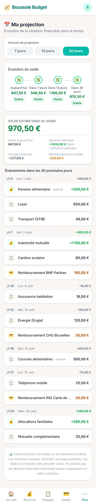

**Projection.** « Dans 7 jours : 348,50 € » alors que la liste montre +920 € à J+7 (FIN-06).

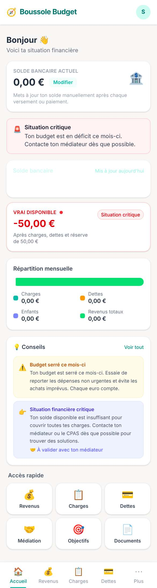

**Budget vide.** −50,00 €, « Situation critique, contacte ton médiateur » (FIN-11).

**Projection aujourd'hui.** Six mois plus tard, un seul événement subsiste (FIN-07).

**Accueil aujourd'hui.** Plus aucune échéance à venir.

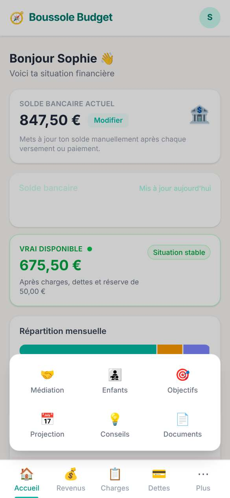

**Menu « Plus ».** La projection y est reléguée (UX-06).

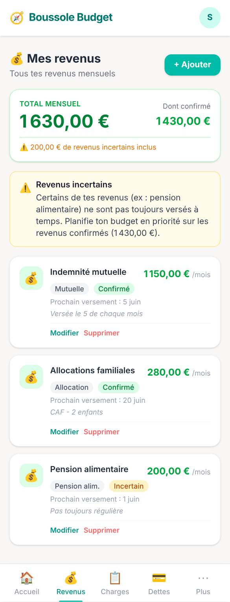

**Revenus.** Le meilleur écran : confirmé et incertain bien distingués.

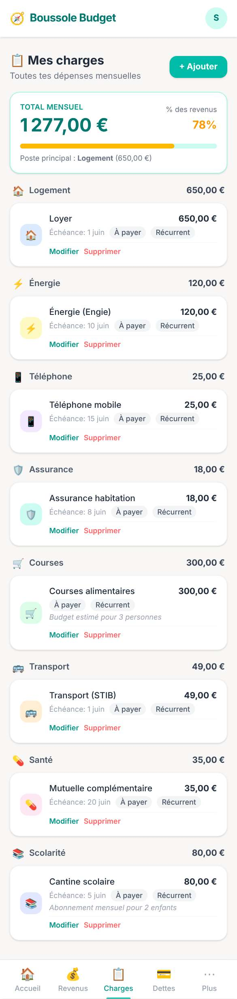

**Charges.** Liens d'action de 16 px de haut (UX-05).

**Ajout d'une charge.** Feuille modale propre, sept champs.

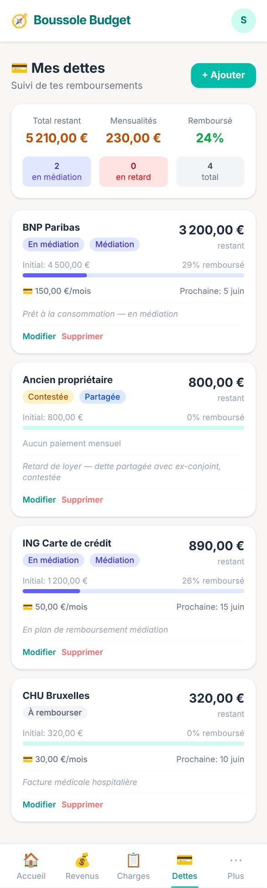

**Dettes.** Statuts utiles (contestée, en médiation).

**Ajout d'une dette.** Accepte des montants négatifs (FIN-15).

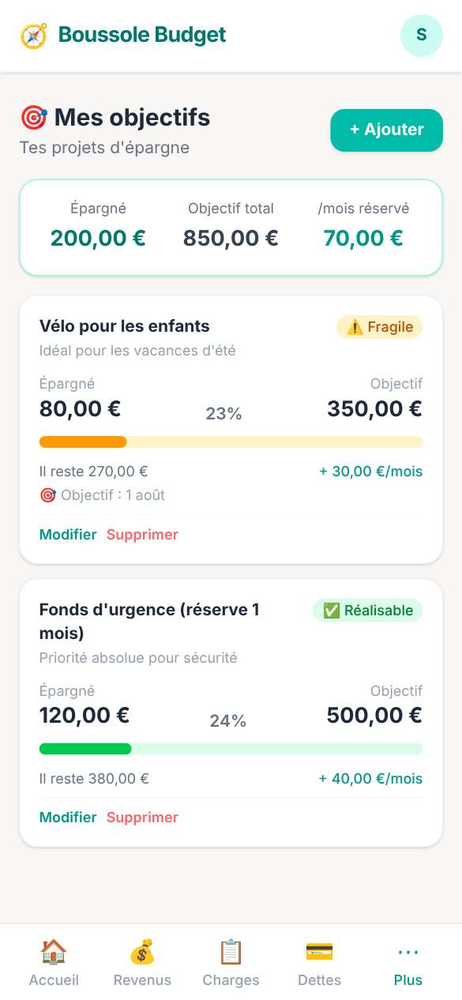

**Objectifs.** Statut « fragile » saisi à la main.

**Frais enfants.** Bon suivi des justificatifs, mauvais effet sur le calcul.

**Médiation.** Dossier fictif, non modifiable (DAT-02).

**Conseils.** Toujours ceux de la démo (ADV-01).

**Documents.** Liste fictive, boutons désactivés.

### Tablette 820 px et ordinateur 1440 px

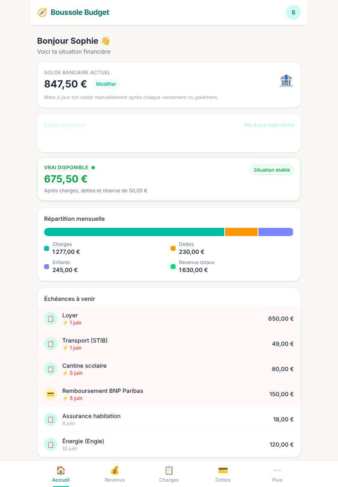

**Tablette.** Colonne mobile centrée.

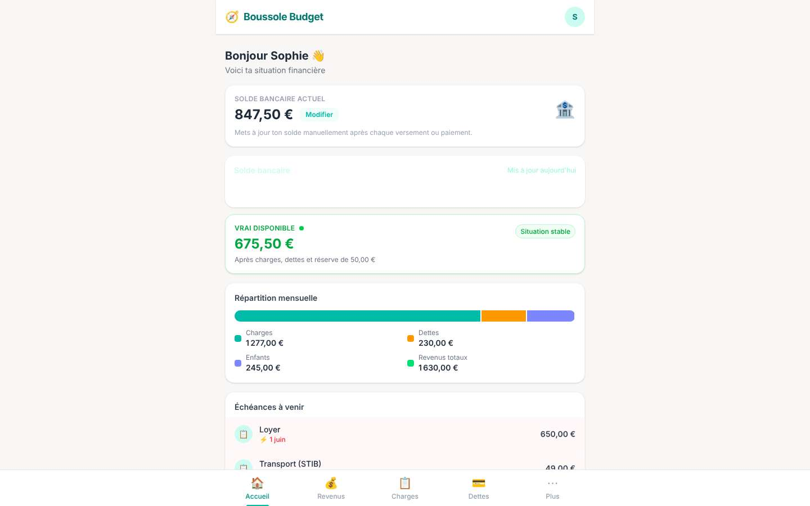

**Ordinateur.** Même colonne, plus de la moitié de l'écran vide.

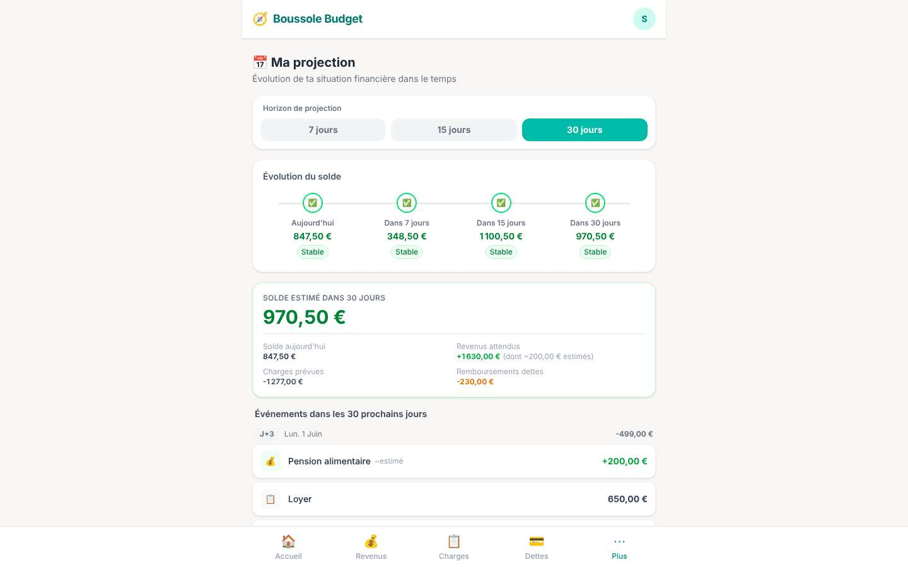

**Projection, ordinateur.**

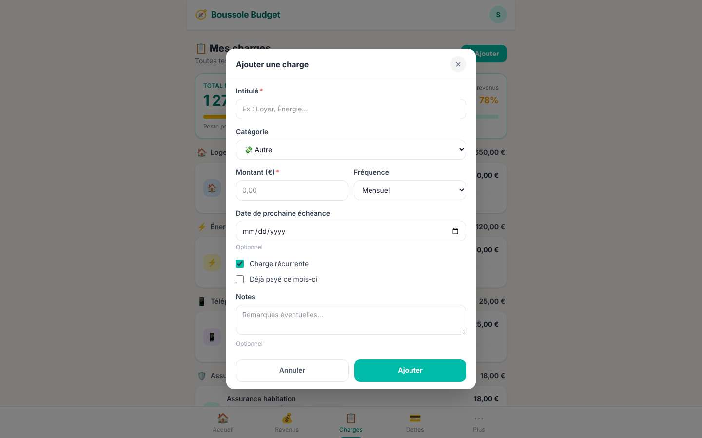

**Formulaire, ordinateur.** Modale centrée, correcte.

Aucun débordement horizontal de 320 px à 1440 px. Le choix « mobile d'abord, colonne unique » est le bon pour ce public : ne pas investir dans une mise en page ordinateur avant la v1.

### Accessibilité mesurée

- **Contraste** : 240 éléments en échec AA sur les 10 pages (axe-core), surtout le gris clair des textes secondaires. Sur une application lue en situation de stress, c'est un défaut de fond.
- **Zones tactiles** : « Modifier » et « Supprimer » mesurent 49 × 16 px et 61 × 16 px, côte à côte. La cible recommandée est 44 × 44 px. Seize zones sous 24 px sur la seule page Charges.
- **Modale** : pas de `role="dialog"`, Échap ne ferme pas, le focus sort de la fenêtre.
- **Formulaires** : libellés non reliés aux champs, deux listes sans nom accessible, aucune annonce d'erreur.
- **Couleur seule** : le niveau de risque repose sur vert, orange, rouge. Le libellé texte existe, c'est bien ; l'icône emoji ne suffit pas pour un lecteur d'écran.

### Direction visuelle

La base est saine : palette sarcelle calme, cartes arrondies, ton tutoyé et bienveillant. **Je ne recommande pas de refonte graphique.** Le « premium » de Boussole viendra de la justesse et de la sobriété, pas d'un habillage. Trois ajustements suffisent :

1.  **Un seul chiffre héros.** « Tu peux dépenser 98 € d'ici le 5 juin », en grand, avec la phrase qui l'explique. Tout le reste passe dessous.
2.  **Moins de couleurs, plus de contraste.** Texte secondaire en gris 600, couleurs sémantiques réservées aux états. Remplacer les emoji par un jeu d'icônes cohérent.
3.  **Des gestes larges.** Chaque échéance est une ligne entière cliquable avec une action « Payé » de 44 px. Plus de liens miniatures.

## Rapport D — Fiabilité financière

**Réponse à la question posée.** Non : en l'état, Boussole ne donne pas d'informations assez fiables pour prendre une décision financière. Le défaut n'est pas une série de bugs à corriger un par un. C'est le modèle de données : il ne connaît ni les dates d'occurrence, ni les opérations réalisées. Sans ces deux notions, aucun des cas ci-dessous ne peut être traité correctement.

### Ce que le moteur confond

| Notion                        | Définition                                                  | Dans le code actuel                                              |
|-------------------------------|-------------------------------------------------------------|------------------------------------------------------------------|
| **Solde bancaire**            | Ce qu'il y a sur le compte à une date donnée.               | Saisi à la main, sans date. Seul point d'ancrage réel.           |
| **Revenu mensuel**            | Un flux moyen, utile pour équilibrer un budget.             | Ajouté tel quel au solde, comme s'il était déjà là.              |
| **Trésorerie prévisionnelle** | Le solde futur, jour par jour.                              | Existe dans `projection.ts`, mais déconnecté du vrai disponible. |
| **Vrai disponible**           | Ce qu'on peut dépenser aujourd'hui sans rater une échéance. | Solde + flux mensuel net − réserve. Mélange un stock et un flux. |
| **Prévu, payé, en retard**    | L'état de chaque occurrence.                                | Un booléen `isPaid` par charge, sans date ni effet.              |

### Définition cible du vrai disponible

Une règle simple, exacte et explicable en une phrase :

**Vrai disponible = point le plus bas du solde projeté sur l'horizon, moins la réserve de sécurité.**

Le solde projeté part du solde saisi, ajoute les revenus *certains* à leur date, retire toutes les échéances non payées à leur date, y compris les retards et les ponctuelles. L'horizon par défaut est de 35 jours, pour toujours couvrir le prochain loyer.

Dépenser X aujourd'hui abaisse tous les soldes futurs de X. Le maximum dépensable sans jamais passer sous la réserve est donc exactement ce point bas moins la réserve.

Sur la démo, cela donne : « Ton compte sera au plus bas le 1er juin, à 148,50 €, après ton loyer. En gardant 50 € de réserve, tu peux dépenser **98,50 €** d'ici là. Si la pension de 200 € arrive, ce sera 298,50 €. » Cette phrase *est* le produit.

### Règles métier à inscrire dans le moteur

1.  Tous les montants en centimes entiers.
2.  Toutes les dates en chaînes locales `AAAA-MM-JJ`, jamais d'UTC.
3.  Une récurrence = montant, fréquence, jour d'ancrage, début, fin. Le 31 retombe sur le dernier jour du mois.
4.  Une occurrence = une récurrence à une date. États : prévue, payée, en retard, annulée.
5.  Marquer « payé » retire l'occurrence et décrémente le solde, sauf si l'utilisateur indique que son solde l'inclut déjà.
6.  Ressaisir le solde crée un nouvel ancrage daté.

7.  Un impayé dont la date est passée reste dû aujourd'hui.
8.  Un revenu incertain n'entre jamais dans le chiffre principal.
9.  Un paiement de dette décrémente le restant dû. La dernière mensualité est plafonnée.
10. Un frais enfant payé est une opération passée. La part à récupérer est une recette incertaine.
11. Un transfert entre ses propres comptes n'est ni un revenu ni une dépense.
12. Capacité d'épargne = revenus certains − charges − dettes − provisions, sur un mois type.

### Scénarios chiffrés

Exécutés contre le code actuel avec le fuseau Europe/Brussels. Script : `scenarios.test.mts`, 16 cas, horloge figée, relançable en une commande.

| N°  | Situation                                                                                        | Attendu                            | Obtenu                                 | Verdict        |
|-----|--------------------------------------------------------------------------------------------------|------------------------------------|----------------------------------------|----------------|
| S0  | Budget entièrement vide, solde 0 €                                                               | État vide, pas d'alerte            | −50,00 €, « danger »                   | **Faux**       |
| S1  | Le 10 du mois. Salaire de 2 000 € déjà reçu, solde 2 100 €, loyer payé, 400 € de courses à venir | 1 650,00 €                         | 2 850,00 €                             | **+1 200 €**   |
| S2  | Loyer de 650 € payé, solde mis à jour, case « payé » cochée                                      | inchangé : 1 800,00 €              | 1 150,00 €                             | **−650 €**     |
| S3  | Solde 100 €, revenu certain 1 150 €, pension incertaine 200 €, charges 1 100 €                   | 100,00 €                           | 300,00 €, « stable »                   | **+200 €**     |
| S4  | Solde 600 €, réparation ponctuelle de 500 € due dans 7 jours                                     | 50,00 €                            | 550,00 €, projection vide              | **+500 €**     |
| S5  | 12 frais enfants de 100 € déjà payés et remboursés à 50 % sur l'année écoulée                    | 1 450,00 €                         | 250,00 €                               | **−1 200 €**   |
| S6  | Démo : conseil d'épargne mensuelle                                                               | 123 € au mieux, −77 € sans pension | « environ 202 € »                      | **Faux**       |
| S7  | Utilisateur aisé, sans enfant, sans dette, réserve réglée à 500 €                                | Aucun conseil hors sujet           | « La pension alimentaire… », « 150 € » | **Hors sujet** |
| S8  | Projection, solde 1 000 €, charges de 100 € (J0), 200 € (J7), 300 € (J30)                        | 900 / 700 / 700 / 400              | 1 000 / 900 / 700 / 700                | **Décalé**     |
| S9  | Revenu hebdomadaire de 300 €, courses hebdomadaires de 100 €, sur 30 jours                       | ≈ +800 €                           | +200 €                                 | **−600 €**     |
| S10 | Démo consultée le 17 novembre 2026                                                               | ≈ 14 événements, retards signalés  | 1 événement, 0 rappel                  | **Vide**       |
| S11 | Rappels : une charge due aujourd'hui, une payée, une en retard                                   | aujourd'hui + en retard            | uniquement la payée                    | **Inversé**    |
| S12 | Dette en retard de 900 € sans mensualité ; dette de 40 € restants à 100 €/mois                   | 900 € dus, 40 € prévus             | 0 € et 100 €                           | **Faux**       |
| S13 | Solde 0,30 €, charges 0,10 € et 0,20 €, réserve 0 €                                              | 0,00 €, neutre                     | −5,5 × 10⁻¹⁷, « danger »               | **Arrondi**    |
| S14 | Marge de 200 €/mois, objectif à 400 €/mois marqué « réalisable »                                 | Objectif irréaliste signalé        | Aucun contrôle                         | **Absent**     |
| S15 | Démo au 29 mai : disponible et point bas                                                         | 98,50 € (point bas 148,50 €)       | 675,50 €, « stable »                   | **+577 €**     |

Deux comportements sont corrects : le regroupement des événements par jour dans la projection, et l'exclusion des dettes suspendues ou soldées. Les conversions annuelle et trimestrielle sont justes.

## Rapport E — Vision Boussole 2.0

### Le marché, tel qu'il est

Prix et couverture relevés en novembre 2026 sur des sources tierces ; à revérifier sur les sites officiels avant toute décision. Aucune de ces applications n'a été testée en main pour cet audit.

| Produit                                                                    | Modèle                                                                                 | Force                                                                                   | Faiblesse pour le public de Boussole                                                                           |
|----------------------------------------------------------------------------|----------------------------------------------------------------------------------------|-----------------------------------------------------------------------------------------|----------------------------------------------------------------------------------------------------------------|
| **YNAB**                                                                   | 14,99 \$/mois ou 109 \$/an, essai 34 jours                                             | Méthode par enveloppes très structurante, communauté fidèle.                            | Anglais uniquement, cher, apprentissage long. Synchronisation bancaire européenne contestée selon les sources. |
| **Actual Budget**                                                          | Gratuit, open source, auto-hébergé (≈ 2 €/mois en hébergement géré)                    | Données locales, enveloppes, transparent.                                               | Demande des compétences techniques. Pas de prise en compte des dettes ou de la médiation.                      |
| **Wallet (BudgetBakers)**                                                  | Gratuit en manuel, Premium ≈ 4 à 5,50 €/mois                                           | Large couverture bancaire annoncée, rapports riches.                                    | Fiabilité de la synchronisation critiquée depuis fin 2024. Orienté analyse du passé.                           |
| **Bankin'**                                                                | Gratuit, Plus 39,90 €/an                                                               | Agrégation et catégorisation automatiques.                                              | Centré France. Banques belges non confirmées, utilisateurs belges mécontents.                                  |
| **Linxo**                                                                  | Gratuit, Premium ≈ 5,99 €/mois ; « Linxo Lab » lancé en janvier 2026                   | Prévision de solde en Premium.                                                          | Centré France, dépend de la connexion bancaire.                                                                |
| **Roov** (belge)                                                           | Gratuit avec achats intégrés ; licence PSD2 sous supervision de la BNB selon l'éditeur | Agrège les banques belges, FR et NL.                                                    | Suivi de dépenses classique. Rien sur les dettes ni la planification sous contrainte.                          |
| **Grassfeld** (NL)                                                         | Gratuit 1 compte, Premium ≈ 1,99 €/mois                                                | Prix très bas, assistant IA depuis avril 2026.                                          | Analyse du passé. Tire les prix du marché vers le bas.                                                         |
| **Applis bancaires** (KBC, BNP Paribas Fortis, ING, Beobank, Revolut, N26) | Incluses                                                                               | Zéro saisie, déjà installées.                                                           | Un seul établissement, aucune vue des échéances hors compte, aucun accompagnement.                             |
| **Wikifin** (FSMA)                                                         | Gratuit, public                                                                        | Calculateur de budget neutre et fiable.                                                 | Outil ponctuel, pas de suivi.                                                                                  |
| **My Libellus** (belge)                                                    | Abonnement (prix non trouvé)                                                           | Décomptes de frais extraordinaires entre parents séparés, selon l'arrêté royal de 2019. | Ne couvre que ce sujet. Concurrent direct du module Enfants.                                                   |

#### Ce que ces produits ont installé comme attentes

- **La synchronisation bancaire est devenue la norme** du « grand public premium ». Elle coûte une licence ou un agrégateur, et c'est le premier motif de plainte quand elle casse.
- **Les prix sont bas** : 2 à 6 €/mois, avec des offres gratuites solides. Un abonnement à 10 € n'a pas de place en Belgique.
- **Tous regardent en arrière.** « Où est passé mon argent ? » Aucun ne répond bien à « Vais-je pouvoir payer mon loyer le 1er ? ».
- **Aucun ne parle de dettes, de médiation, de pension alimentaire ou de revenus de remplacement.**

### Positionnement recommandé

**Je te déconseille le « grand public premium ».** Sur ce terrain, il faut la synchronisation bancaire pour exister, les prix sont écrasés, et un fondateur seul affronte des équipes de vingt personnes. L'origine du projet désigne un meilleur terrain, que personne n'occupe.

**Cible prioritaire :** les personnes à budget serré ou instable en Belgique francophone. Revenus de remplacement, séparation récente, dettes en cours de règlement, revenus irréguliers. Elles ont un besoin aigu, quotidien, et aucun outil pensé pour elles.

**Proposition de valeur :** « Boussole te dit en dix secondes ce que tu peux dépenser aujourd'hui sans rater une échéance. Sans connecter ta banque. »

**Pourquoi choisir Boussole plutôt qu'une autre :**

1.  **Elle regarde devant.** Un chiffre daté, expliqué, prudent par défaut.
2.  **Elle fonctionne sans connexion bancaire.** C'est un choix, pas un manque : beaucoup de personnes en règlement collectif de dettes ne disposent que d'un pécule versé par leur médiateur, et d'autres refusent de donner accès à leurs comptes.
3.  **Elle connaît la réalité belge.** Pécule de médiation, frais extraordinaires, allocations familiales régionales, pécule de vacances, régularisation d'énergie.
4.  **Elle se partage avec un accompagnant.** Un budget lisible à apporter à son rendez-vous, plutôt qu'une farde de tickets.

Honnêtement : aujourd'hui, personne n'a de raison de choisir Boussole. Ces quatre raisons n'existent qu'une fois le moteur refait.

### Les pistes, une par une

| Piste                                       | Problème résolu                                    | Cible                             | Complexité                     | Risques et dépendances                                                                            | Décision                                                  |
|---------------------------------------------|----------------------------------------------------|-----------------------------------|--------------------------------|---------------------------------------------------------------------------------------------------|-----------------------------------------------------------|
| **A. Vrai disponible au jour le jour**      | « Puis-je dépenser aujourd'hui ? »                 | Tous                              | Moyenne                        | Dépend du nouveau modèle daté.                                                                    | **Cœur, P0**                                              |
| **A. Récurrences et échéancier**            | Oublis, retards, frais de rappel                   | Tous                              | Moyenne                        | Cas limites de dates (31, février).                                                               | **Cœur, P0**                                              |
| **A. Anticipation des mois difficiles**     | Factures annuelles qui tombent d'un coup           | Budgets serrés                    | Moyenne                        | Demande de connaître les charges annuelles.                                                       | **P2**                                                    |
| **B. « Puis-je me permettre cet achat ? »** | Décision d'achat ponctuelle                        | Tous                              | Faible une fois le moteur fait | Aucun : c'est le même calcul avec une dépense en plus.                                            | **P2, très bon ratio**                                    |
| **B. Explication des calculs**              | Confiance dans le chiffre                          | Tous                              | Faible                         | Aucun.                                                                                            | **P0, avec le moteur**                                    |
| **B. Conseils contextuels**                 | Savoir quoi faire ensuite                          | Personnes en difficulté           | Faible techniquement           | Responsabilité du contenu. Relecture professionnelle nécessaire.                                  | **P2, règles simples et relues**                          |
| **B. Assistant IA conversationnel**         | Poser une question en langage naturel              | Tous                              | Élevée                         | Chiffres inventés, conseil trompeur, coût par utilisateur, données sensibles envoyées à un tiers. | **Pas maintenant**                                        |
| **C. Objectifs d'épargne**                  | Se projeter au-delà de la survie                   | Budgets stabilisés                | Faible                         | Démotivant si la marge est nulle : n'afficher que si la capacité est positive.                    | **P2, faisabilité calculée**                              |
| **C. Réduction des dettes**                 | Voir la sortie du tunnel                           | Endettés                          | Faible                         | Ne jamais suggérer un ordre de remboursement en médiation.                                        | **P1 (paiements), P2 (date de fin)**                      |
| **D. Séparation et frais partagés**         | Récupérer la part de l'autre parent                | Parents séparés                   | Moyenne                        | Concurrent existant (My Libellus). Règles juridiques à valider.                                   | **P2, décompte trimestriel en PDF**                       |
| **D. Revenus irréguliers**                  | Budget sans salaire fixe                           | Intérimaires, indépendants        | Faible                         | Aucun : c'est le traitement « certain / incertain » bien fait.                                    | **P0, inclus dans le moteur**                             |
| **D. Médiation de dettes**                  | Suivre son plan, préparer ses rendez-vous          | Personnes en médiation ou RCD     | Moyenne                        | Activité réglementée. Deux procédures très différentes (amiable, règlement collectif).            | **P2, après entretiens avec 2 services**                  |
| **D. Offre pour accompagnants**             | Budgets lisibles et à jour pour les professionnels | Services de médiation, CPAS, asbl | Élevée                         | Cycles de vente longs, secret professionnel, marchés publics.                                     | **P3, mais à explorer dès maintenant par des entretiens** |
| **E. Onboarding progressif**                | Premier chiffre en 2 minutes                       | Tous                              | Faible                         | Aucun.                                                                                            | **P1**                                                    |
| **E. Notifications**                        | Ne pas oublier une échéance                        | Tous                              | Moyenne                        | Demande un compte ou une PWA installée. Surcharge si mal dosé.                                    | **P2, 1 rappel par échéance, rien d'autre**               |
| **E. Visualisations**                       | Comprendre d'un coup d'œil                         | Tous                              | Faible                         | Tentation du tableau de bord décoratif.                                                           | **Une seule : la courbe du solde**                        |
| **Connexion bancaire**                      | Éviter la saisie                                   | Budgets classiques                | Très élevée                    | Licence ou agrégateur payant, maintenance, support.                                               | **Pas maintenant**                                        |
| **Coffre à documents**                      | Centraliser ses papiers                            | Personnes en médiation            | Élevée                         | Stockage de pièces très sensibles, responsabilité lourde.                                         | **Retirer**                                               |

#### Sur l'intelligence artificielle

Le calcul doit rester déterministe, testé et explicable. Un modèle de langage n'a pas sa place dans le chiffre. Le seul usage défendable à terme est de *reformuler* en langage courant un résultat déjà calculé, sans jamais produire de nombre lui-même. Il coûte de l'argent par utilisateur et envoie des données sensibles à un sous-traitant : à n'envisager qu'après la première version payante, et jamais pour des recommandations de crédit ou de placement.

### L'expérience cible

1.  **Première ouverture, trois questions.** Combien as-tu sur ton compte ? Quand arrive ta prochaine rentrée d'argent, et de combien ? Quelles factures tombent d'ici là ? Premier chiffre en moins de deux minutes.
2.  **Écran « Aujourd'hui ».** Un chiffre : ce que tu peux dépenser, jusqu'à quelle date. Une phrase qui l'explique. Dessous, les trois prochaines échéances et la courbe du solde.
3.  **Un geste par échéance.** « Payé » sur la ligne. Le solde et le chiffre se mettent à jour.
4.  **Un rendez-vous par semaine.** « Ton solde est-il toujours de 412 € ? » Oui, ou le nouveau montant. C'est toute la maintenance.
5.  **Le budget s'enrichit ensuite**, à son rythme : charges annuelles, dettes, objectifs, frais partagés.

### Modèle économique

Le public le plus concerné est aussi celui qui peut le moins payer. Lui facturer l'essentiel serait à la fois injuste et commercialement faible. D'où trois étages, dans cet ordre :

| Offre                  | Contenu                                                                                                    | Prix indicatif                                                      | Quand                                        |
|------------------------|------------------------------------------------------------------------------------------------------------|---------------------------------------------------------------------|----------------------------------------------|
| **Gratuite, complète** | Vrai disponible, échéancier, dettes, export. Un appareil, données locales.                                 | 0 €                                                                 | Dès la v1                                    |
| **Personnelle**        | Synchronisation chiffrée entre appareils, rappels, décomptes de frais partagés en PDF, simulateur d'achat. | Hypothèse : 2,99 €/mois ou 29 €/an                                  | Après 100 utilisateurs actifs à 4 semaines   |
| **Accompagnants**      | Vue en lecture des budgets partagés volontairement par les personnes suivies, export pour dossier.         | Hypothèse : par professionnel et par mois, à fixer après entretiens | Après un pilote gratuit avec 1 ou 2 services |

Ma conviction : **le revenu durable viendra des accompagnants**, pas des particuliers. C'est du logiciel métier vendu à des structures belges, terrain que tu connais. La version gratuite sert alors de canal d'acquisition et de preuve d'utilité. Cette conviction reste une hypothèse tant que cinq professionnels ne l'ont pas confirmée.

**Marché belge puis européen :** le néerlandais est indispensable pour couvrir la Belgique, et vient avant toute extension. La France est proche par la langue mais différente par les dispositifs (commission de surendettement, CAF) : c'est une adaptation, pas une traduction.

### Points à faire valider

- **Médiation de dettes** : activité réservée aux institutions agréées, avocats, officiers ministériels et mandataires de justice. Vérifier ce que l'application peut dire et faire sans y entrer.
- **Règlement collectif de dettes** : dans cette procédure, les revenus sont en principe versés au médiateur, qui reverse un pécule. Le modèle doit le permettre. À confirmer avec un praticien.
- **RGPD** : dès qu'un serveur stocke les données, il faut une base légale, une politique de confidentialité, un hébergement en UE et probablement une analyse d'impact. Une indemnité de mutuelle peut révéler un état de santé.
- **Connexion bancaire** : service d'information sur les comptes soumis à l'agrément de la BNB, ou passage par un prestataire agréé selon le montage contractuel.
- **Conseil financier** : rester dans l'éducation budgétaire. Toute recommandation de crédit ou de placement fait entrer dans un cadre supervisé par la FSMA.
- **Frais extraordinaires** : l'arrêté royal du 22 avril 2019 fixe une liste, un décompte trimestriel avec justificatifs et un paiement sous 15 jours, sauf jugement contraire. À valider avant de générer des décomptes.
- **Accessibilité** : vérifier si l'acte européen sur l'accessibilité s'applique au service et si l'exemption des microentreprises joue.

## Rapport F — Roadmap priorisée

Les efforts sont des estimations en jours de travail concentré, exécution assistée par IA, relecture et tests compris. Ils servent à comparer les chantiers entre eux.

### P0 — Calcul, perte de données, sécurité

| ID   | Chantier                                                                                                       | Impact                                      | Effort  | Dépend de | Critères d'acceptation                                                                                               |
|------|----------------------------------------------------------------------------------------------------------------|---------------------------------------------|---------|-----------|----------------------------------------------------------------------------------------------------------------------|
| P0-1 | Filet de tests et intégration continue                                                                         | Protège tout le reste                       | 0,5 j   | —         | Les 16 scénarios sont dans le dépôt. La CI échoue si l'un d'eux échoue. Fuseau Europe/Brussels imposé.               |
| P0-2 | Nouveau modèle daté : centimes, dates locales, récurrences, occurrences, statuts, migration des données v1     | Corrige FIN-01 à FIN-08, FIN-12 à FIN-14    | 3 à 5 j | P0-1      | S1, S2, S4, S5, S8 à S13 passent. Une charge mensuelle créée en mai apparaît seule en juin, juillet, août.           |
| P0-3 | Vrai disponible par point bas, avec explication                                                                | Le produit devient vrai                     | 1 à 2 j | P0-2      | S3 et S15 passent (98,50 € sur la démo). L'écran montre la date et la cause du point bas.                            |
| P0-4 | Sortir la démo de l'état par défaut. Brancher Conseils sur l'état réel. Masquer Médiation et Documents.        | Corrige DAT-01, DAT-02, ADV-01, ADV-02      | 1 j     | —         | Une première ouverture ne montre aucune donnée fictive. Aucun texte en dur ne mentionne pension, médiateur ou 150 €. |
| P0-5 | Sauvegarde : export et import JSON, schéma versionné et validé, hydratation sans écrasement                    | Corrige DAT-03, DAT-04, FIN-15              | 1 j     | P0-2      | Export, effacement du navigateur, import : état identique. Un fichier corrompu est refusé avec un message.           |
| P0-6 | Hygiène : mise à jour de Next, en-têtes de sécurité, carte fantôme, double confirmation, erreurs de formulaire | Corrige TEC-02, TEC-03, UX-01, UX-03, UX-04 | 1 j     | —         | `npm audit` sans alerte critique. Une seule confirmation. Chaque champ invalide affiche son message.                 |

### P1 — Parcours fondamentaux

| ID   | Chantier                                                                                                   | Impact                                                | Effort               | Dépend de   | Critères d'acceptation                                                               |
|------|------------------------------------------------------------------------------------------------------------|-------------------------------------------------------|----------------------|-------------|--------------------------------------------------------------------------------------|
| P1-1 | Onboarding en trois questions                                                                              | Premier chiffre utile immédiat                        | 1,5 j                | P0-3, P0-4  | Un testeur novice obtient son vrai disponible en moins de 2 minutes, sans aide.      |
| P1-2 | Écran « Aujourd'hui » : chiffre, phrase, prochaines échéances, courbe                                      | Usage quotidien en 10 secondes                        | 2 j                  | P0-3        | Le chiffre et sa date sont visibles sans défilement sur un écran de 390 × 667.       |
| P1-3 | Échéancier unifié avec « Payé » en un geste, section « En retard »                                         | Maintenance minimale                                  | 2 j                  | P0-2        | Marquer payé : un seul geste, solde et chiffre mis à jour, annulation possible.      |
| P1-4 | Navigation à quatre onglets et écran Réglages (prénom, réserve, effacer, charger la démo)                  | Clarté                                                | 1 j                  | P0-4        | Toute rubrique est à deux gestes au plus. La réserve se règle.                       |
| P1-5 | Accessibilité AA : contrastes, cibles de 44 px, modale, libellés, focus                                    | Utilisable par tous                                   | 2 j                  | P1-2, P1-3  | Zéro violation axe-core sérieuse ou critique. Parcours complet au clavier.           |
| P1-6 | Dettes : enregistrer un paiement, restant dû, date de fin estimée                                          | Corrige FIN-10                                        | 1 j                  | P0-2        | S12 passe. Un paiement réduit le restant dû et le solde.                             |
| P1-7 | Application installable (manifeste, icône, hors ligne), mentions légales et confidentialité                | Stockage plus durable sur iOS, mise en ligne possible | 1 j                  | P0-6        | Installable sur iOS et Android. Fonctionne sans réseau.                              |
| P1-8 | Tests avec 5 personnes réelles, dont la personne à l'origine du projet et un professionnel de la médiation | Valide ou invalide le besoin                          | 2 à 3 j de ton temps | P1-1 à P1-3 | 5 sessions observées. Au moins 3 personnes reviennent d'elles-mêmes dans la semaine. |

### P2 — Forte valeur ajoutée, après validation du besoin

| ID   | Chantier                                                               | Impact                             | Effort  | Dépend de                  | Critères d'acceptation                                                                        |
|------|------------------------------------------------------------------------|------------------------------------|---------|----------------------------|-----------------------------------------------------------------------------------------------|
| P2-1 | Simulateur « Puis-je me permettre… ? »                                 | Fort, différenciant                | 1 j     | P0-3                       | Montant et date saisis : réponse oui ou non, nouveau point bas affiché.                       |
| P2-2 | Provisions pour charges annuelles                                      | Fort pour budgets serrés           | 2 j     | P0-2                       | Une taxe de 300 € en mars réserve 25 €/mois et abaisse le vrai disponible d'autant.           |
| P2-3 | Compte utilisateur et synchronisation chiffrée (hébergement UE)        | Condition de l'offre payante       | 5 à 8 j | P0-5, avis RGPD            | Deux appareils à jour en moins de 5 secondes. Le serveur ne stocke que des données chiffrées. |
| P2-4 | Rappels d'échéance                                                     | Moyen                              | 2 j     | P1-7 ou P2-3               | Un rappel la veille d'une échéance non payée, désactivable.                                   |
| P2-5 | Frais partagés : décompte trimestriel en PDF                           | Fort pour parents séparés          | 3 j     | P0-2, validation juridique | Décompte daté avec liste des frais, parts et justificatifs référencés.                        |
| P2-6 | Mode médiation : pécule, plan, synthèse à imprimer pour le rendez-vous | Fort, ouvre le canal professionnel | 3 j     | Entretiens avec 2 services | Un médiateur juge la synthèse utilisable telle quelle.                                        |
| P2-7 | Objectifs à faisabilité calculée et conseils conditionnels relus       | Moyen                              | 2 j     | P0-3                       | S6 et S14 passent. Chaque conseil cite le chiffre qui le déclenche.                           |

### P3 — Plus tard, sous condition

- **Portail accompagnants** : après un pilote concluant.
- **Néerlandais** : avant toute communication à l'échelle belge.
- **Import de relevés CSV** : première étape, peu coûteuse, avant toute connexion bancaire.
- **Connexion bancaire, assistant IA, applications natives, comptes multiples et transferts** : seulement si les utilisateurs payants le demandent.

### Matrice impact / effort

#### Impact fort, effort faible

À faire tout de suite

- **P0-1** Tests et CI
- **P0-3** Vrai disponible par point bas
- **P0-4** Sortir la démo
- **P0-5** Export et import
- **P1-1** Onboarding
- **P2-1** Simulateur d'achat

#### Impact fort, effort élevé

À planifier

- **P0-2** Modèle daté
- **P1-2 / P1-3** Aujourd'hui et échéancier
- **P1-5** Accessibilité AA
- **P2-3** Compte et synchronisation
- **P2-6** Mode médiation

#### Impact modéré, effort faible

À glisser entre deux chantiers

- **P0-6** Hygiène
- **P1-4** Navigation et réglages
- **P1-6** Paiements de dettes
- **P1-7** Application installable

#### Impact incertain, effort élevé

À ne pas faire maintenant

- **—** Connexion bancaire
- **—** Assistant IA
- **—** Coffre à documents
- **—** Applications natives
- **—** Portail accompagnants avant pilote

### Ordre d'exécution

1.  **Semaine 1.** P0-1, P0-4, P0-6. L'application cesse de mentir sur ce qu'elle sait faire, et les tests existent.
2.  **Semaines 2 et 3.** P0-2, P0-3, P0-5. Le moteur est juste, expliqué et sauvegardable.
3.  **Semaines 4 et 5.** P1-1 à P1-4, P1-6, P1-7. Le parcours quotidien tient en quelques gestes.
4.  **Semaine 6.** P1-5 et P1-8. Cinq personnes l'utilisent. En parallèle : trois entretiens avec des services de médiation.
5.  **Point de décision.** Si moins de 3 testeurs sur 5 reviennent seuls, on s'arrête et on comprend pourquoi avant d'écrire une ligne de plus.
6.  **Semaines 7 à 10, si le signal est bon.** P2-1, P2-2, P2-3, puis l'offre personnelle. P2-5 ou P2-6 selon ce que les entretiens ont montré.

## Conclusion — Les huit réponses

### 1. Niveau de maturité

Maquette interactive. Interface à 60 % d'un MVP, moteur de calcul à refaire, sécurité des données et tests à zéro. Compte 15 à 20 % du chemin vers une version commercialisable. Le code existant est une bonne base : petit, typé, sans dette lourde.

### 2. Les dix problèmes les plus importants

1.  Le vrai disponible mélange un stock et un flux, sans dates (FIN-01).
2.  « Payé » n'a aucun effet et provoque un double comptage (FIN-02).
3.  Aucune récurrence réelle : l'application se vide avec le temps (FIN-07).
4.  La projection est décalée d'un jour en Belgique (FIN-06).
5.  Les revenus incertains sont comptés comme acquis (FIN-03).
6.  Les dépenses ponctuelles sont invisibles (FIN-04).
7.  La démo est l'état par défaut, sans moyen de démarrer à vide (DAT-01).
8.  Conseils, Médiation et Documents affichent des données fictives (ADV-01, DAT-02).
9.  Aucune sauvegarde ni export (DAT-03).
10. Aucun test (TEC-01).

### 3. Ce qui mérite d'être conservé

- Le concept de vrai disponible et la réserve de sécurité.
- La distinction revenu confirmé / incertain, à brancher sur le calcul.
- L'écran de projection par jours et sa liste d'événements.
- Les statuts de dette (contestée, en médiation, suspendue).
- Le suivi des justificatifs pour les frais enfants.
- Le ton, la palette, les feuilles modales, les formulaires.
- La stack et l'architecture : calculs en fonctions pures, état central, trois dépendances.

### 4. Proposition de valeur principale

« Savoir en dix secondes ce que tu peux dépenser aujourd'hui sans rater une échéance. Sans connecter ta banque. »

### 5. L'expérience Boussole 2.0

Trois questions à l'ouverture, un chiffre daté et expliqué, un geste par échéance, un point de contrôle par semaine. Tout le reste est optionnel et arrive plus tard.

### 6. Les cinq meilleurs rapports impact / effort

1.  Vrai disponible par point bas, avec sa phrase d'explication (P0-3).
2.  Sortir la démo et poser l'onboarding en trois questions (P0-4, P1-1).
3.  « Payé » en un geste qui met le solde à jour (P1-3).
4.  Export et import des données (P0-5).
5.  Les 16 scénarios en tests automatiques (P0-1).

### 7. À ne pas développer maintenant

Connexion bancaire, assistant IA, coffre à documents, applications natives, portail professionnel, mise en page ordinateur, statistiques par catégorie, score de risque, comptes multiples, ludification.

### 8. Plan vers une première version commercialisable

Six semaines pour une version gratuite juste et utilisable (P0 puis P1), validée par cinq utilisateurs réels. Un point de décision. Puis quatre semaines pour le compte, la synchronisation et l'offre personnelle, pendant qu'un pilote gratuit tourne avec un ou deux services de médiation wallons. La première facture viendra plus probablement d'une structure que d'un particulier.

## Transparence — Ce qui n'a pas été vérifié

- **Déploiement en ligne** : aucun trouvé. Tout a été testé en local.
- **Appareils réels** : tests sur Chromium émulé (390, 820, 1440 et 320 px). Ni Safari iOS, ni lecteur d'écran réel, ni téléphone d'entrée de gamme.
- **Éviction du stockage par Safari** : citée d'après la documentation WebKit, non reproduite.
- **Conflit entre onglets** (DAT-05) : établi par lecture du code.
- **Concurrents** : recherche documentaire. Aucune application installée ni testée. Prix issus de sites tiers parfois contradictoires.
- **Droit belge** : tous les points du rapport E sont à confirmer par un juriste ou un service agréé.
- **Usage réel** : aucune donnée d'utilisation n'existe. Le besoin reste une hypothèse forte, pas un fait mesuré.
- **Estimations d'effort et prix proposés** : ordres de grandeur.

**Sources consultées le 17 novembre 2026**

- [Testachats — Meilleures applications de budget](https://www.test-achats.be/argent/comptes-epargne/news/applications-budget)
- [Testachats — Dossier applications budget](https://www.test-achats.be/argent/comptes-epargne/dossier/applications-budget)
- [The Penny Hoarder — YNAB 2026](https://www.thepennyhoarder.com/budgeting/ynab-review/)
- [Freenance — YNAB pour l'Europe](https://freenance.io/products/ynab-review-2026-budgeting-app-worth-it-european-investors/)
- [Actual Budget — synchronisation bancaire](https://actualbudget.org/docs/advanced/bank-sync/)
- [Actual Budget — feuille de route 2026](https://actualbudget.org/blog/roadmap-for-2026)
- [Finny — Wallet by BudgetBakers 2026](https://getfinny.app/blog/wallet-budgetbakers-review-2026)
- [MoneyVox — Bankin'](https://www.moneyvox.fr/epargne/bankin)
- [App Store — Linxo Lab](https://apps.apple.com/fr/app/linxo-lab-budget-finances/id6478117034)
- [App Store — Roov](https://apps.apple.com/app/id1397413918)
- [MT/Sprout — Grassfeld](https://mtsprout.nl/persbericht/grassfeld-maakt-op-unieke-manier-zichtbaar-waar-je-geld-blijft-veel-mensen-zijn-zich-niet-bewust-van-hun-uitgaven)
- [Wikifin — Établir un budget](https://www.wikifin.be/fr/budget-payer-emprunter-et-assurer/budget-et-gestion-de-budget/comment-etablir-un-budget)
- [ULB — My Libellus](https://droit-prive.ulb.be/app/uploads/2026/03/My-Libellus-Un-guide-numerique-de-separation-LAGASSE-10.02.2026.pdf)
- [Wallonie — Agrément médiation de dettes](https://wallonie.be/fr/demarches/obtenir-un-agrement-pour-un-service-de-mediation-de-dettes)
- [Notaire.be — Frais extraordinaires](https://www.notaire.be/separation-et-divorce/nouveautes/parents-separes-une-liste-de-frais-extraordinaires-offre-plus-de-securite)
- [Droits Quotidiens — Réclamer les frais extraordinaires](https://www.droitsquotidiens.be/fr/question/comment-reclamer-les-frais-extraordinaires-lautre-parent)
- [WebKit — Stockage et applications installées](https://webkit.org/blog/11338/cname-cloaking-and-web-privacy/)
- [DNB — Licence d'information sur les comptes](https://www.dnb.nl/en/sector-information/open-book-supervision/laws-and-eu-regulations/psd2/account-information-services-licence-requirements-in-cases-involving-outsourcing-or-multiple-parties)
- [Enable Banking — Prestataires open banking](https://enablebanking.com/blog/the-open-banking-provider-landscape-in-europe-what-to-know-before-you-choose)
- [DH — Campagne « stop aux dettes », sept. 2026](https://www.dhnet.be/dernieres-depeches/2026/09/04/lancement-de-la-campagne-stop-aux-dettes-contre-le-surendettement-N2ROQAZXBJCRVDPYK4DFPFCSNQ/)
